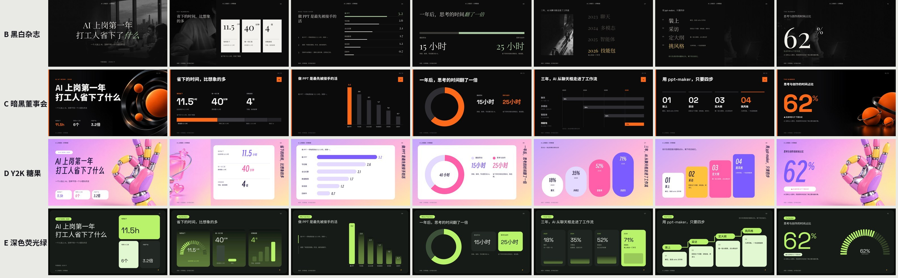
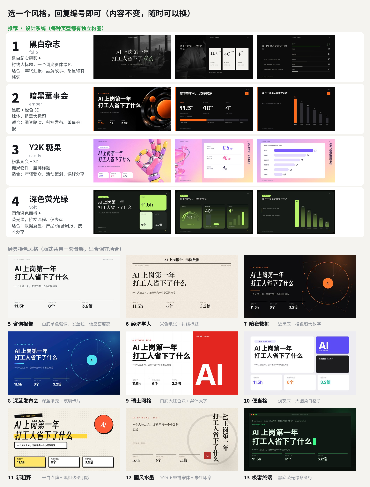

# ppt-maker：让 AI 做出没有「AI 味」的 PPT

一个给 AI 智能体（Claude Code、WorkBuddy 等支持 Skills 的工具）用的 PPT 技能包。国产模型（如 DeepSeek）也能用。

它会先采访你、给出大纲，确认后生成**原生可编辑的 PowerPoint（.pptx）**：
- **数据带动效**：柱子自己长、数字自己滚、环形图当场变化，全是 PowerPoint 原生动画。
- **图表自动生成**：数字直接画成图表，文本框、数字都能在 PowerPoint 里点开就改。
- **逐页讲稿**：每页附演讲备注，另存一份讲稿 Markdown。
- **自带审美规范和自查**：排不满、字溢出、出界、字太小，生成后自动检查。
- **字体随文件走**：开源字体按用字子集嵌入，对方电脑没装也能正常显示。



## 风格菜单

同一份稿件，一句话换风格。推荐 4 套「设计系统」（每种页型都有独立构图），另有 9 种经典换色风格：



网页版（可放大）：[examples/风格菜单.html](examples/风格菜单.html)

## 安装

1. 下载本仓库（右上角 Code → Download ZIP），解压后把文件夹重命名为 `ppt-maker`。
2. 放进你的智能体的 skills 文件夹，例如：
   - Claude Code：`~/.claude/skills/ppt-maker`
   - WorkBuddy：`~/.workbuddy/skills/ppt-maker`
3. 第一次使用时，智能体会运行 `python3 tools/setup_env.py` 自动安装依赖（python-pptx、Pillow、fonttools）。

## 使用

对智能体说（**记得点名 ppt-maker**，否则它可能用自带的 PPT 工具）：

> 用 ppt-maker 帮我做一个 10 分钟的 PPT，主题是……

它会：
1. **采访你 5 个问题**：讲给谁、讲多久、最想让听众记住哪句话、手上有什么材料、选哪种风格（会给你看风格菜单）。
2. **给出大纲表**：每页的版式、结论式标题、放什么数据。你点头再动手。
3. **生成 pptx + 讲稿**，并自动自查。

想换风格：直接说「换成 2 号风格」，内容一个字不用改。

## 目录

```
SKILL.md            智能体读的说明书（流程、规则）
tools/              生成器：build_deck.py（入口）、layouts.py（通用版式）、designs/（4 套设计系统）、anim.py（原生动画）…
references/         稿件格式、审美规范、动效指南
examples/           示例稿件（ai_demo.json 覆盖全部常用版式）、风格菜单
assets/             设计系统配图、示例照片
fonts/pack/         离线字体包（SIL OFL 1.1）
```

## 致谢与授权

- 代码：MIT License（见 [LICENSE](LICENSE)）。
- 主题配色和动效命名参考 [html-ppt-skill](https://github.com/lewislulu/html-ppt-skill)（MIT）。其余第三方来源见 [NOTICE.md](NOTICE.md)。
- 字体：思源黑体 / 思源宋体、得意黑、霞鹜文楷、Inter、Space Grotesk、Playfair Display，均为 SIL Open Font License 1.1。
- 示例照片来自 Wikimedia Commons，署名见 [assets/5g_images/CREDITS.md](assets/5g_images/CREDITS.md)。设计系统配图为 AI 生成。
